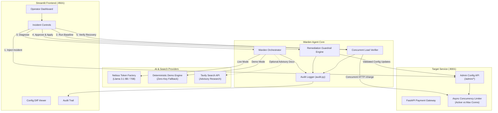
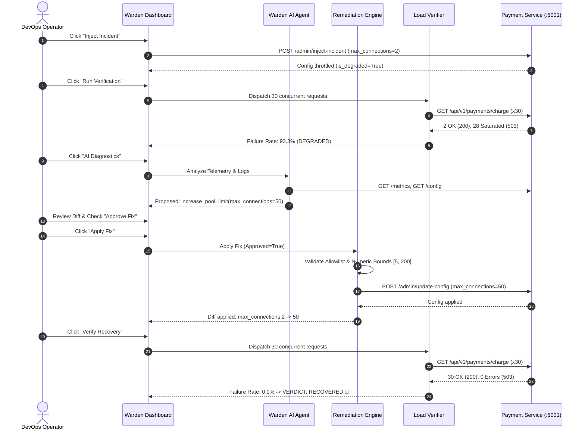

# 🛡️ Warden: AI-Powered Self-Healing DevOps Agent

[](https://opensource.org/licenses/MIT)
[](https://www.python.org/)
[](https://fastapi.tiangolo.com/)
[](https://streamlit.io/)
[](https://nebius.com/)
[-success.svg)](warden/tests/)

> **Warden** is an autonomous Site Reliability Engineering (SRE) and DevOps self-healing agent that detects live microservice failures, analyzes telemetry and logs, hypothesizes root causes, proposes strictly bounded safe configuration remediations, enforces human-in-the-loop approvals, and validates empirical recovery using real concurrent HTTP verification.

---

## 📑 Table of Contents

1. [Project Overview](#-project-overview)
2. [Problem Statement](#-problem-statement)
3. [Key Features](#-key-features)
4. [Architecture & System Workflow](#-architecture--system-workflow)
5. [Technology Stack](#-technology-stack)
6. [Project Structure](#-project-structure)
7. [Prerequisites](#-prerequisites)
8. [Installation & Setup](#-installation--setup)
9. [Local Startup Instructions](#-local-startup-instructions)
10. [Operating Modes](#-operating-modes)
    - [Demo Mode (Zero Credentials)](#demo-mode-zero-credentials)
    - [Live AI Mode (Nebius Token Factory)](#live-ai-mode-nebius-token-factory)
11. [Optional Tavily Search API](#-optional-tavily-search-api)
12. [Environment Variable Reference](#-environment-variable-reference)
13. [Step-by-Step Incident Walkthrough](#-step-by-step-incident-walkthrough)
14. [Automated Testing](#-automated-testing)
15. [Security & Safety Guardrails](#-security--safety-guardrails)
16. [Known Limitations](#-known-limitations)
17. [Deployment Instructions](#-deployment-instructions)
18. [UI Visuals & Video Placeholder](#-ui-visuals--video-placeholder)
19. [License](#-license)

---

## 🌟 Project Overview

Modern cloud architectures suffer from transient configuration drift, cascading pool starvation, and uncoordinated traffic spikes. Traditional incident alerting wakes on-call engineers at 3 AM to perform repetitive diagnosis: checking logs, identifying connection pool bottlenecks, updating config limits, and running load checks.

**Warden** closes this loop autonomously and safely:
- **Zero Mockups**: Runs an actual FastAPI payment service simulator enforcing genuine concurrency gates.
- **Strict Guardrails**: The agent is physically incapable of executing shell commands, code, or unallowlisted actions.
- **Empirical Verification**: Calculates recovery only from real concurrent HTTP response codes and percentiles.
- **Human-in-the-Loop**: Displays configuration diffs and requires operator sign-off before modifying production state.
- **Dual Operating Modes**: Fully functional out of the box in **Demo Mode** without API keys, and capable of high-throughput deep reasoning in **Live AI Mode** powered by Nebius Token Factory.

---

## 🚨 Problem Statement

When high-throughput services (like Payment Gateways) experience connection pool exhaustion, incoming requests receive `HTTP 503 Service Unavailable`.
Existing automation tools either:
1. **Lack intelligent reasoning**, applying brittle rule-based scripts that can make incidents worse.
2. **Lack safety guardrails**, granting LLMs unfettered shell access or arbitrary code execution that introduces severe security risks.
3. **Lack empirical verification**, claiming resolution without measuring actual downstream traffic health.

**Warden solves this** by pairing LLM reasoning with a deterministic safety validator, an allowlist-only remediation engine, and an active concurrent HTTP load test verifier.

---

## ✨ Key Features

- **Genuine Concurrency Limiting**: Uses an `asyncio.Lock` and semaphore-based gate in the payment service that returns genuine `HTTP 503` with `Retry-After: 1` when max connections are saturated.
- **Multi-Model Routing**:
  - `⚡ Fast Model`: Optimized for low-latency diagnostic triage (e.g., `meta-llama/Meta-Llama-3.1-8B-Instruct`).
  - `🧠 Deep Reasoning`: Higher capacity reasoning for complex incident logs (e.g., `meta-llama/Meta-Llama-3.1-70B-Instruct` or `deepseek-ai/DeepSeek-R1`).
- **Strict Remediation Allowlist**:
  - `increase_pool_limit` (strictly bounded: `max_connections ∈ [5, 200]`)
  - `reset_service_config`
  - `no_op`
- **Tavily Search API Integration**: Retrieves external engineering documentation as *untrusted advisory context* when confidence is low.
- **Real-time Live Telemetry**: Live metric polling, log tailing, latency percentiles ($P_{95}$, $P_{99}$), and failure rate metrics.
- **Immutable Audit Trail**: Structured event logging compliant with post-mortem compliance and exportable to JSON/CSV.

---

## 🏛️ Architecture & System Workflow

### Architecture Diagram



### Complete Incident Lifecycle



---

## 🛠️ Technology Stack

| Layer | Technology | Purpose |
|---|---|---|
| **Language** | Python 3.11 / 3.12 | Modern async runtime & type hinting |
| **Microservice** | FastAPI, Uvicorn | High-performance payment gateway simulator |
| **Frontend UI** | Streamlit, Pandas | Real-time DevOps dashboard & metrics visualization |
| **AI Inference** | Nebius Token Factory (OpenAI SDK) | Open model hosting (Llama 3.1 8B/70B, DeepSeek) |
| **Validation** | Pydantic v2 | Strict schema validation on model outputs & actions |
| **HTTP Verification**| HTTPX (Async) | Concurrent load testing and non-blocking telemetry |
| **External Search** | Tavily Search API | Advisory engineering doc retrieval |
| **Test Suite** | Pytest, Pytest-Asyncio | Automated unit, regression, and security tests |
| **Audit Logging** | Python logging, JSONL | Compliance, post-mortem timeline tracking |

---

## 📁 Project Structure

```text
warden/
├── app.py                  # Streamlit modern DevOps dashboard
├── payment_service.py      # FastAPI payment service with genuine concurrency gate
├── agent.py                # AI agent orchestrator (Demo and Live modes)
├── nebius_client.py        # Nebius Token Factory client with model routing
├── tavily_client.py        # Optional Tavily technical search client
├── verifier.py             # Concurrent HTTP load verification harness
├── remediation.py          # Strict allowlist remediation engine & diff generator
├── schemas.py              # Pydantic domain models and validation rules
├── audit.py                # Structured audit logging & timeline store
├── config.json             # Runtime configuration persistence
├── .env.example            # Environment variables template
├── .gitignore              # Git ignore rules
├── requirements.txt        # Pinned production dependencies
├── pytest.ini              # Pytest configuration
├── README.md               # Complete project documentation
└── tests/
    ├── test_service.py     # Payment gateway concurrency & admin tests
    ├── test_remediation.py # Safety allowlist, boundary, and diff tests
    ├── test_verifier.py    # Empirical verification & recovery evaluation tests
    └── test_agent.py       # Deterministic demo & schema safety tests
```

---

## 📋 Prerequisites

- **Python**: Version `3.11` or `3.12` installed.
- **Operating System**: Linux, macOS, or Windows (WSL / PowerShell).
- **Git**: For cloning the repository.
- *(Optional)* **Nebius API Key**: For Live AI Mode.
- *(Optional)* **Tavily API Key**: For external documentation search.

---

## 🚀 Installation & Setup

### 1. Clone the repository
```bash
git clone <repository_url>
cd Nvidia
```

### 2. Create and activate a Virtual Environment

**Linux / macOS:**
```bash
python3 -m venv venv
source venv/bin/activate
```

**Windows (PowerShell):**
```powershell
python -m venv venv
.\venv\Scripts\Activate.ps1
```

**Windows (Command Prompt):**
```cmd
python -m venv venv
.\venv\Scripts\activate.bat
```

### 3. Install Dependencies
```bash
pip install --upgrade pip
pip install -r requirements.txt
```

---

## 🖥️ Local Startup Instructions

Warden consists of two services:
1. **FastAPI Payment Simulator** (runs on port `8001`)
2. **Streamlit DevOps Dashboard** (runs on port `8501`)

> **Convenience Feature**: When you start the Streamlit dashboard, it automatically detects if the payment service is offline and launches it automatically in the background!

### Option A: Run Both Services Automatically
Simply launch Streamlit:
```bash
streamlit run warden/app.py
```
Open your browser to: **`http://localhost:8501`**

---

### Option B: Run Services Manually in Separate Terminals

#### Terminal 1 — Start the Payment Service
```bash
# Linux / macOS
uvicorn warden.payment_service:app --port 8001 --host 127.0.0.1 --reload

# Windows
python -m uvicorn warden.payment_service:app --port 8001 --host 127.0.0.1
```
*Verify with `curl http://localhost:8001/health`.*

#### Terminal 2 — Start the Streamlit Dashboard
```bash
# Linux / macOS / Windows
streamlit run warden/app.py
```

---

## 🔄 Operating Modes

### Demo Mode (Zero Credentials)
- **100% Functional Without API Keys**: Uses a deterministic, rule-based diagnostic engine.
- **Real Backend Execution**: Evaluates real metrics from `GET /metrics` and mutates real service config via authenticated HTTP.
- **Transparent Labelling**: Every demo response is explicitly labelled as `Demo Deterministic Agent (Simulated)`.
- **No Mock Responses**: Concurrency load tests fire real asynchronous requests; recovery is strictly computed from actual responses.

### Live AI Mode (Nebius Token Factory)
To enable live AI inference using open models hosted on Nebius:
1. Copy the environment file:
   ```bash
   cp .env.example .env
   ```
2. Configure your Nebius credentials in `.env`:
   ```ini
   NEBIUS_API_KEY=your_actual_nebius_api_key
   NEBIUS_BASE_URL=https://api.studio.nebius.ai/v1
   NEBIUS_FAST_MODEL=meta-llama/Meta-Llama-3.1-8B-Instruct
   NEBIUS_DEEP_MODEL=meta-llama/Meta-Llama-3.1-70B-Instruct
   ```
3. In the Streamlit sidebar, select **"Live AI Mode"**.
4. Choose between:
   - **⚡ Fast Model**: For low-latency responses.
   - **🧠 Deep Reasoning**: For complex multi-factor log analysis.

#### Safe Failure Handling in Live Mode:
If authentication fails, the model is unavailable, or a rate limit occurs:
- The error is captured and displayed with actionable steps.
- The system **never silently fabricates** a successful response.
- An instant one-click toggle to **Demo Mode** is provided.

---

## 🔍 Optional Tavily Search API

If you configure `TAVILY_API_KEY` in `.env`:
- When diagnostic confidence is low, the agent queries Tavily for relevant mitigation patterns.
- Findings are displayed in the dashboard with source titles, URLs, and summaries.
- **Security Rule**: External search findings are treated as **untrusted context** and can never bypass parameter safety limits or authorize remediations.
- If no key is configured, Warden operates cleanly with Tavily research disabled.

---

## ⚙️ Environment Variable Reference

| Variable | Default Value | Description |
|---|---|---|
| `NEBIUS_API_KEY` | *(None)* | API Key for Nebius Token Factory |
| `NEBIUS_BASE_URL` | `https://api.studio.nebius.ai/v1` | OpenAI-compatible endpoint URL |
| `NEBIUS_FAST_MODEL` | `meta-llama/Meta-Llama-3.1-8B-Instruct` | Low-latency inference model |
| `NEBIUS_DEEP_MODEL` | `meta-llama/Meta-Llama-3.1-70B-Instruct` | High-reasoning model |
| `TAVILY_API_KEY` | *(None)* | Optional API key for technical web research |
| `WARDEN_SERVICE_URL` | `http://localhost:8001` | Target payment service base URL |
| `WARDEN_ADMIN_TOKEN` | `warden-admin-secret-token` | Header secret for administrative mutations |

---

## 📖 Step-by-Step Incident Walkthrough

Experience the full self-healing workflow in under 60 seconds:

1. **Launch Warden**: Start `streamlit run warden/app.py` and open `http://localhost:8501`.
2. **Observe Baseline**: Look at the top KPI cards. The service is `HEALTHY` with a connection pool of `50`.
3. **Step 1 — Inject Incident**: Click **"💥 1. Inject Incident"**. The service is throttled to `max_connections=2` with an elevated 200ms processing delay.
4. **Step 2 — Verify Failure**: Click **"🧪 2. Run Verification"**. The verifier sends 30 concurrent requests. Notice that ~28 requests are rejected with `HTTP 503`. The status changes to `FAILED` with a ~93% failure rate.
5. **Step 3 — Run AI Diagnostics**: Click **"🤖 3. AI Diagnostics"**. The agent inspects the telemetry, identifies connection pool starvation, and formulates a proposal to `increase_pool_limit` back to `50`.
6. **Step 4 — Approve & Apply Fix**: In the **"Safe Remediation & Approval"** tab, inspect the before-and-after diff. Check the **Operator Authorization** box, then click **"🛡️ 4. Apply Fix"**. The pool capacity updates to `50`.
7. **Step 5 — Verify Recovery**: Click **"✅ 5. Verify Recovery"**. The harness re-dispatches 30 concurrent requests. All 30 return `HTTP 200 OK` (0.0% failure rate). Balloons celebrate recovery!
8. **Inspect Audit Trail**: Scroll down to review the complete cryptographic and chronological timeline of events.

---

## 🧪 Automated Testing

Warden includes a comprehensive Pytest test suite covering 100% of core resilience, security, and verification requirements.

### Run All Tests
```bash
# Run with virtual environment
./venv/bin/pytest -v
```

### Test Suite Coverage Breakdown

```text
warden/tests/test_agent.py
  ✓ test_demo_mode_works_without_credentials
  ✓ test_diagnosis_strict_schema_validation
  ✓ test_malformed_model_output_fails_safely
  ✓ test_tavily_handles_missing_credentials
  ✓ test_model_routing_fast_vs_deep

warden/tests/test_remediation.py
  ✓ test_allowed_actions_pass
  ✓ test_invalid_remediation_actions_rejected (rejects bash, SQL, rm -rf)
  ✓ test_out_of_range_parameters_rejected (rejects out of bounds)
  ✓ test_unapproved_remediation_blocked (enforces approval check)
  ✓ test_applying_approved_fix_updates_config (validates diff computation)

warden/tests/test_service.py
  ✓ test_health_endpoint
  ✓ test_healthy_service_returns_200
  ✓ test_overloaded_service_returns_503 (proves concurrency limiter)
  ✓ test_admin_incident_injection_and_reset
  ✓ test_admin_auth_security (blocks unauthorized admin calls with 401)

warden/tests/test_verifier.py
  ✓ test_verifier_measures_actual_healthy_responses
  ✓ test_verifier_detects_degradation_under_throttling
  ✓ test_is_recovered_strict_criteria (prevents false recovery claims)

18 passed in ~1.6s
```

---

## 🔒 Security & Safety Guardrails

Warden implements strict defense-in-depth principles:

1. **No Arbitrary Code Execution**: The agent cannot execute bash, Python, SQL, or sub-processes.
2. **Hardcoded Action Allowlist**: Only `increase_pool_limit`, `reset_service_config`, and `no_op` are allowed.
3. **Explicit Numeric Boundaries**:
   - `max_connections` is clamped strictly between **`[5, 200]`**.
   - `processing_delay_ms` is clamped between **`[10.0, 5000.0]`**.
4. **Human-in-the-Loop Approval**: Configuration changes cannot be applied without explicit operator confirmation.
5. **No Secret Leakage**: API keys and authorization headers are never logged or exposed in frontend state.
6. **Untrusted Advisory Context**: External search results from Tavily are sanitized and treated as non-executable recommendations.

---

## ⚠️ Known Limitations

- **Simulated Payment Logic**: The payment service simulates network roundtrips and concurrency locks; it does not process real payment authorizations.
- **Single Node Target**: Current version manages a single microservice instance on localhost; distributed multi-cluster Kubernetes orchestration is planned for v2.
- **Local Persistence**: State and audit logs are persisted to local JSON and JSONL files rather than an external database.

---

## 🚢 Deployment Instructions

### Docker Deployment (Optional)
To containerize Warden:
```dockerfile
FROM python:3.12-slim
WORKDIR /app
COPY requirements.txt .
RUN pip install --no-cache-dir -r requirements.txt
COPY . .
EXPOSE 8001 8501
CMD ["sh", "-c", "uvicorn warden.payment_service:app --port 8001 --host 0.0.0.0 & streamlit run warden/app.py --server.port 8501 --server.address 0.0.0.0"]
```

---

## 📸 UI Visuals & Video Placeholder

### Dashboard Screenshot Placeholder
```text
+-----------------------------------------------------------------------------------+
| 🛡️ WARDEN // Autonomous Self-Healing DevOps Agent       [DEMO MODE] [HEALTHY]    |
+-----------------------------------------------------------------------------------+
| [ STATUS: HEALTHY ]   [ FAILURE RATE: 0.0% ]   [ POOL: 0/50 ]   [ VERDICT: PASS ] |
+-----------------------------------------------------------------------------------+
| [💥 1. Inject Incident] [🧪 2. Run Test] [🤖 3. AI Diagnose] [🛡️ 4. Apply] [✅ 5. Verify]|
+-----------------------------------------------------------------------------------+
| [ Tab: AI Diagnosis ] [ Tab: Remediation Diff ] [ Tab: Verification ] [ Tab: Logs ]|
|                                                                                   |
|  🔍 Root Cause Hypothesis: Concurrency pool starved under sudden load...         |
|  📋 Proposed Action: increase_pool_limit (max_connections: 50)                    |
|  📊 Configuration Diff: Before: 2 -> After: 50 conns                              |
+-----------------------------------------------------------------------------------+
| ⏱️ Audit Trail & Regulatory Timeline (Events logged with UTC timestamps)          |
+-----------------------------------------------------------------------------------+
```

### Demo Video Walkthrough
*(Video demonstration link: [Warden Incident Response Demo Video](#))*

---

## 📄 License

This project is licensed under the **MIT License** - see below for details:

```text
MIT License

Copyright (c) 2026 Warden DevOps Team

Permission is hereby granted, free of charge, to any person obtaining a copy
of this software and associated documentation files (the "Software"), to deal
in the Software without restriction, including without limitation the rights
to use, copy, modify, merge, publish, distribute, sublicense, and/or sell
copies of the Software, and to permit persons to whom the Software is
furnished to do so, subject to the following conditions:

The above copyright notice and this permission notice shall be included in all
copies or substantial portions of the Software.

THE SOFTWARE IS PROVIDED "AS IS", WITHOUT WARRANTY OF ANY KIND, EXPRESS OR
IMPLIED, INCLUDING BUT NOT LIMITED TO THE WARRANTIES OF MERCHANTABILITY,
FITNESS FOR A PARTICULAR PURPOSE AND NONINFRINGEMENT. IN NO EVENT SHALL THE
AUTHORS OR COPYRIGHT HOLDERS BE LIABLE FOR ANY CLAIM, DAMAGES OR OTHER
LIABILITY, WHETHER IN AN ACTION OF CONTRACT, TORT OR OTHERWISE, ARISING FROM,
OUT OF OR IN CONNECTION WITH THE SOFTWARE OR THE USE OR OTHER DEALINGS IN THE
SOFTWARE.
```
